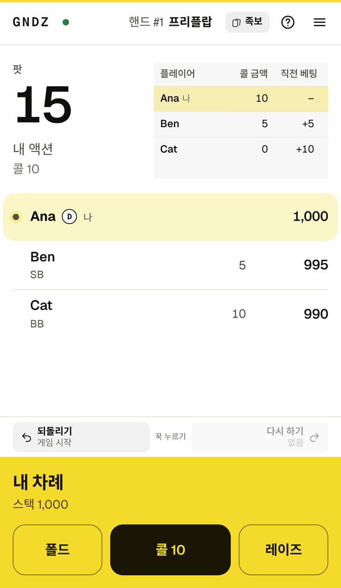
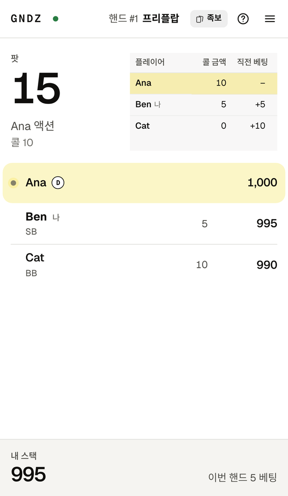
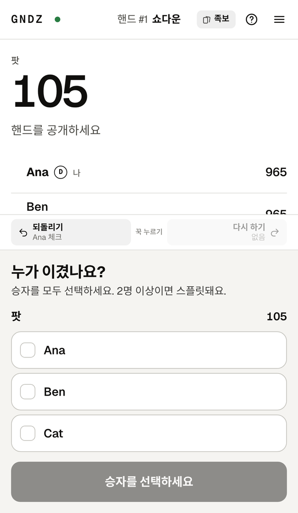
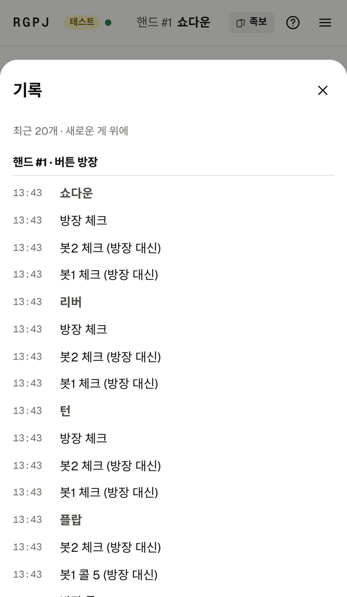

# 칩 포커

**칩은 폰으로, 카드는 테이블에서.** 친구들이랑 실제 카드로 홀덤을 칠 때, 칩 대신 각자 폰으로 베팅·콜·레이즈하고 팟을 나눠 갖는 실시간 칩 관리 앱이에요.

**바로 쓰기:** [chip-poker.pages.dev](https://chip-poker.pages.dev)

<p>
  
  
  
  
</p>

## 쓰는 법

1. 한 명이 **테이블 만들기**를 누르고 4글자 코드, QR, 링크 중 하나로 친구들을 불러요. 계정 없이 이름만 넣으면 돼요.
2. 방을 만든 사람이 **방장**이에요. 방장이 핸드를 시작하면 블라인드와 순서는 자동이에요.
3. 각자 자기 차례에 폴드 / 체크·콜 / 레이즈를 눌러요. 카드는 실제로 돌려요.
4. 쇼다운에서 카드를 깐 뒤 방장이 **승자를 고르면** 팟이 지급돼요. 여러 명을 고르면 나눠 가져요.

## 주요 기능

- **노리밋 홀덤 규칙**: 블라인드 자동, 순서 강제, 최소 레이즈, 짧은 올인, 사이드 팟까지 계산해요.
- **베팅 현황표**: 팟 옆에 [플레이어 | 콜 금액 | 직전 베팅]이 보여요.
- **용어 설명·족보**: 한국어 홀덤 용어집, 누르고 있는 동안만 보이는 족보 그림표가 있어요.
- **방장 전용 조작**: 승자 지정, 다음 핸드, 되돌리기 / 다시 하기는 방장만 할 수 있어요. 되돌리기는 꾹 눌러야 돼서 실수로 눌리지 않아요.
- **폰 없는 사람 자리**: 메뉴에서 자리를 추가하고 다른 사람이 대신 눌러줄 수 있어요.
- **기록**: 메뉴 → 기록에서 핸드별로 누가 언제 무엇을 했는지 최근 100개까지 볼 수 있어요.
- **테스트 판**: [`/test`](https://chip-poker.pages.dev/test)로 들어가면 봇 1~7명이 앉은 판이 바로 차려져요. 봇 차례에는 봇의 버튼이 바로 떠서 혼자서도 끝까지 돌려볼 수 있어요.
- **정산**: 바이인·리바이·최종 손익과 최소 송금 횟수를 계산해요.
- **큰 화면 모드**: 아이패드나 노트북을 테이블 가운데 두고 팟, 차례, 스택을 크게 보여줘요.

## 원작에서 바뀐 점

이 저장소는 [KarthikSubramanian07/Piss-Poker](https://github.com/KarthikSubramanian07/Piss-Poker)를 포크해서 고친 버전이에요.

- 전체 한국어화 (한국 홀덤 용어 기준)
- 방장이 나가면 테이블이 닫히도록 수정 (예전 방에 친구가 방장으로 남던 문제)
- 베팅 현황표, 용어 설명, 족보 그림표 추가
- 승자 지정·되돌리기·다음 핸드를 방장 전용으로, 꾹 누르는 되돌리기 / 다시 하기 버튼 추가
- 테스트 판(`/test`), 기록 화면 추가

## 개발

```bash
npm install
npm run dev          # 워커(:8787) + Vite(:5173), /api는 프록시
```

`http://localhost:5173`을 창 두 개(일반 + 시크릿)로 열면 혼자서 두 명으로 칠 수 있어요. 혼자 여러 명을 테스트하려면 `http://localhost:5173/test`를 쓰면 돼요.

```bash
npm run typecheck    # 타입 검사
npm run test         # 단위 테스트 + 워커 테스트
npx playwright test  # 폰 여러 대를 흉내 낸 e2e 테스트
npm run shots        # 모든 화면 스크린샷 (/tmp/pp-shots)
```

## 배포

Cloudflare에 GitHub를 연결해 두어서, **`main`에 머지하면 자동으로 배포돼요.**

- **서버 (Worker `chip-poker-api`)**: Workers Builds, 루트 폴더 `worker`
- **사이트 (Pages `chip-poker`)**: 빌드 `npm run build`, 출력 `dist`, `NODE_VERSION=22`

변경은 브랜치에서 작업하고 PR로 올린 뒤 Merge해요.

## 기술 스택

React 19, Vite, TypeScript, Cloudflare Pages · Workers · Durable Objects (SQLite, WebSocket), Vitest, Playwright.

## 라이선스

[MIT](LICENSE). 원작 © Karthik Subramanian. 원작의 저작권 표시는 [LICENSE](LICENSE)에 그대로 유지해요.
